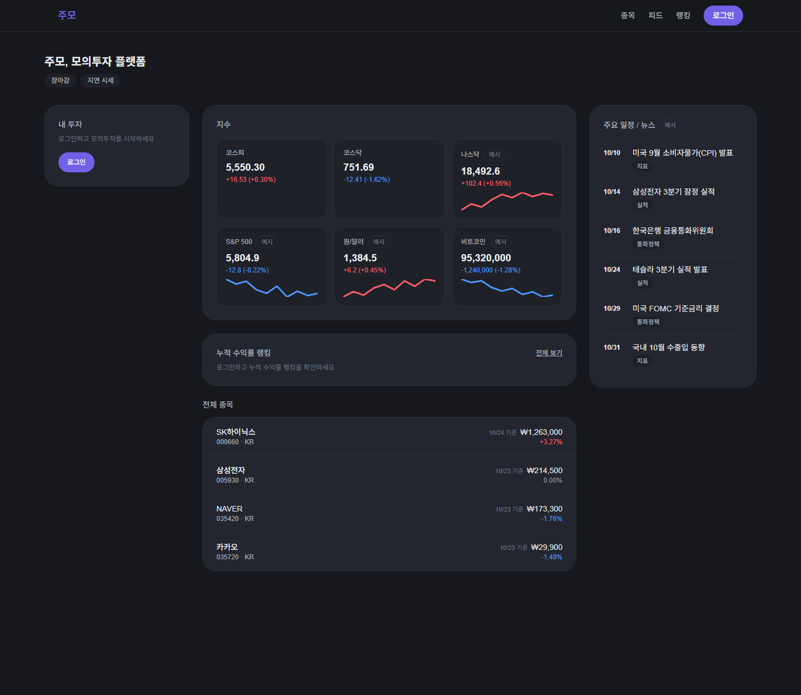
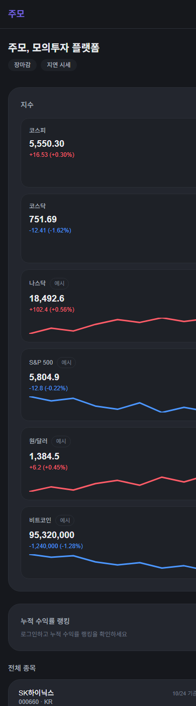
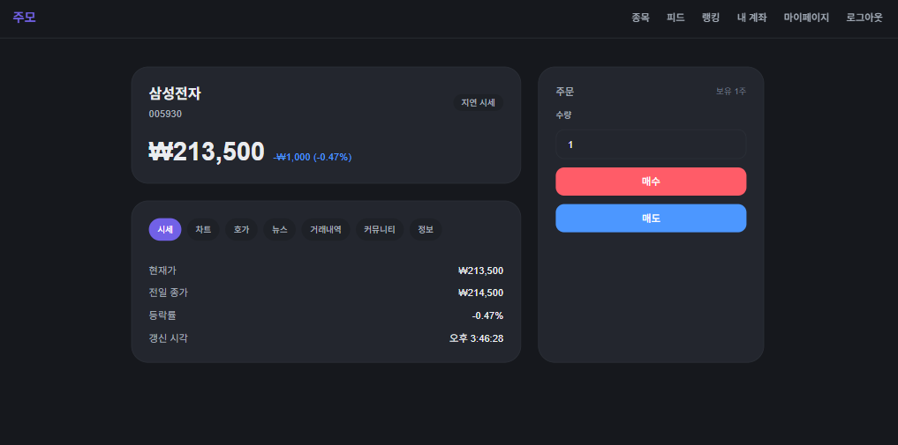
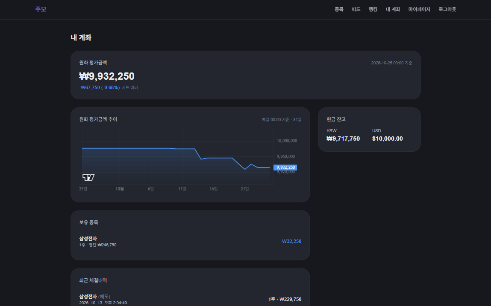
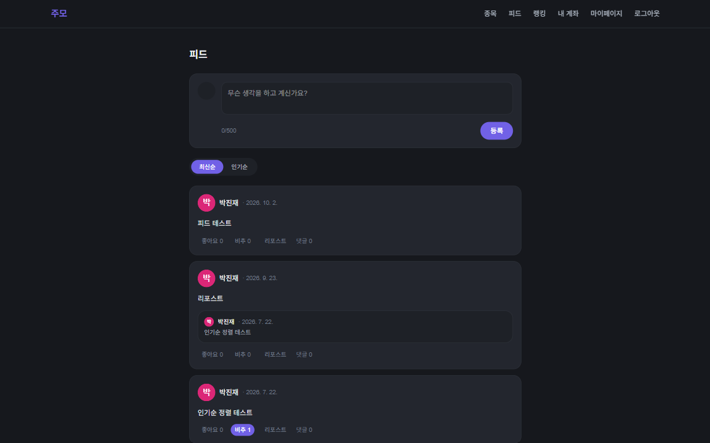

# 주모 (Jumo)

> 국내 주식 **모의투자 + 소셜** 플랫폼. 가상 시드 1,000만원으로 실제 시세에 매매를 연습하고, 종목 이야기를 피드에서 나눈다.

🔗 **Live Demo:** https://jumo-one.vercel.app — Google 계정으로 가입하면 시드 **1,000만원**이 지급됩니다. 실제 돈은 오가지 않습니다.

📄 **Docs:** [`/docs`](./docs) · 📜 [개인정보처리방침](https://jumo-one.vercel.app/privacy)

---

## 화면

| 홈 (1440px) | 홈 (390px) |
|---|---|
|  |  |

| 종목 상세 (캔들 · 호가 · 주문) | 내 계좌 (자산 · 추이 그래프) |
|---|---|
|  |  |

| 피드 |
|---|
|  |

## 주요 기능

| 영역 | 내용 |
|------|------|
| 시세 | 한국투자증권(KIS) Open API **지연 시세**. 현재가 50초 캐시, 10호가 3초 폴링. 국내 4종목(삼성전자 · SK하이닉스 · 카카오 · NAVER) |
| 차트 | 캔들 + 거래량, **일/주/월** 전환, 크로스헤어 OHLC, 전체화면 (`lightweight-charts`) |
| 거래 | 시장가 매수/매도. 체결 즉시 보유 · 잔고 반영. 거래 내역 |
| 계좌 | 총자산 · 누적 손익 · 수익률, 원화 평가금액 추이 그래프(매일 00:00 KST 스냅샷) |
| 소셜 | 글 작성 · 종목 태그, 댓글, 좋아요/싫어요, 리포스트(인용), 팔로우, 공개 프로필 |
| 랭킹 | **누적 수익률** 랭킹 (가입 시드 대비, 매일 00:05 · 09:05 KST 자동 집계) |
| 홈 | 코스피 · 코스닥 실데이터, 관심 종목, 랭킹 프리뷰. 해외지수 · 환율 · BTC · 뉴스 · 일정은 **"예시" 배지**가 붙은 목업 |

시세는 로그인 없이 홈에서 볼 수 있고, 종목 상세 · 거래 · 피드 · 랭킹은 로그인이 필요합니다. v1.0은 다크 테마 전용입니다.

## 설계 하이라이트

각 항목은 "문제 → 선택 → 근거" 순서입니다.

**1. 주문 체결 정합성 — 비관적 락**
같은 계좌에서 동시에 두 주문이 들어오면 잔고 초과 · 이중 체결이 날 수 있다. 체결은 `execute_order` RPC 하나로 모으고, 그 안에서 `SELECT … FOR UPDATE`로 계좌 · 보유 행을 잠근 뒤 검증 → 체결 → 기록을 한 트랜잭션으로 처리한다. 검증 코드(`V1`~`V6`: 수량 · 종목 · 시세 신선도 · 잔고 · 보유)를 반환해 UI가 사유를 그대로 보여준다. 순차 엣지케이스 SQL 테스트 외에, 실제 Supabase에 유저를 만들어 RPC를 동시 호출하는 [동시성 테스트](./supabase/tests/concurrency_execute_order.mjs)가 매수 · 매도 레이스 **8/8 PASS**로 이중 체결이 없음을 증명한다.

**2. 권한 설계 — RLS + 서버 전용 RPC + 클라이언트 쓰기 경로 제거**
브라우저 번들에는 anon 키가 들어 있으므로 "클라이언트가 할 수 있는 일"이 곧 공격 표면이다. 17개 테이블에 RLS를 걸고, `SECURITY DEFINER` RPC(KIS 토큰 조회/저장, 시세 upsert)는 `service_role`만 실행하도록 회수했다(#137 — Supabase는 새 함수마다 anon · authenticated에 EXECUTE를 직접 부여하므로 `public` 회수만으로는 안 지워진다는 것을 운영 DB 권한 조회로 확인). 잔고는 `execute_order`만 바꾸므로 `accounts` UPDATE, 주문은 RPC만 만들므로 `orders` INSERT/UPDATE, 수정 UI가 없는 `posts` · `comments` UPDATE 정책을 모두 제거했다.

**3. 0원 체결 차단 — 데이터 계층 제약**
KIS가 `rt_cd=0`(성공)인데 값이 빈 응답을 돌려주는 경로가 있었고, 그 0이 시세 캐시에 들어가면 0원에 체결될 수 있었다(#120). 체결 함수나 호출부 각각에 가드를 넣는 대신 `price_quotes.price > 0` CHECK 제약으로 **모든 writer가 수렴하는 지점**에서 막았다(#121). 0 이하 시세 행은 존재 자체가 불가능하다.

**4. 외부 API 제약 대응 — KIS 초당 2건**
300ms 간격 3번째 호출에서 `EGW00201`로 거부되는 것을 실측했다. 다건 조회는 **순차 호출 + 캐시**가 전제다. 국내지수는 서버에서 `unstable_cache` 60초로 묶어 사용자 수와 무관하게 TTL당 2건(코스피 · 코스닥)만 나가며, Vercel 인스턴스 간 공유되는 것을 운영에서 확인했다. 현재가는 `price_quotes` 50초 캐시 — `execute_order`의 시세 신선도 한도(60초)보다 짧게 잡아 캐시가 `V3_STALE_QUOTE` 판정 전에 갱신되게 했다.

**5. 스케줄 작업 — pg_cron + Vercel Cron**
DB 안에서 끝나는 일(자산 스냅샷 00:00 KST, 랭킹 집계 00:05 · 09:05 KST)은 pg_cron, 외부 API를 쳐야 하는 일(장 마감 후 목록 시세 일괄 갱신)은 Vercel Cron으로 나눴다. Vercel Hobby는 시 단위 정밀도(±59분)라 15시대로 잡으면 장 마감(15:30) 전에 돌 수 있어 **평일 16시대(UTC 07시)** 로 미뤘다. 놓친 실행은 숨기지 않고 목록의 "MM/DD 기준" 표기로 드러나게 했다(#165).

**6. 랭킹 뷰 security definer 트레이드오프**
`accounts`의 SELECT 정책은 본인 행만이라, 랭킹 뷰가 invoker 권한으로 join하면 타 유저 행이 전부 걸러져 유저가 1명일 때는 드러나지 않던 버그가 있었다(#180). `accounts` RLS를 넓히는 대신 뷰를 정의자 권한으로 바꾸고, 노출 컬럼을 표시용(닉네임 · 총자산 · 수익률 · 순위)으로 제한하고, anon 권한 전부 회수 · authenticated는 SELECT만 남겼다. Security Advisor의 "Security Definer View" 경고는 의도된 것임을 마이그레이션 주석에 기록했다.

**7. 정직한 표기**
지연 시세는 헤더에 "지연 시세" 배지, 오늘 시세가 아니면 "MM/DD 기준", 실데이터가 아닌 위젯은 "예시" 배지. 없는 기능을 있는 것처럼 보이게 하지 않는다.

## 기술 스택

| 영역 | 선택 |
|------|------|
| Frontend | Next.js 16 (App Router) · React 19 · TypeScript · Tailwind CSS 4 · lightweight-charts 5 |
| Backend / DB | Supabase — PostgreSQL · RLS · RPC(plpgsql) · pg_cron · Google OAuth |
| 외부 데이터 | 한국투자증권 KIS Open API (현재가 · 호가 · 일봉 · 국내지수) |
| Infra | Vercel (Hobby) · Vercel Cron |

## 라우트

```
/                  홈 (지수 · 관심/전체 종목 · 랭킹 프리뷰 · 일정/뉴스 예시) — 로그인 불필요
/stocks            종목 목록
/stocks/[id]       종목 상세 · 차트 · 호가 · 주문 · 뉴스(예시) · 커뮤니티
/feed              피드 (전역 최신순 / 인기순)
/feed/[postId]     글 상세 · 댓글
/ranking           누적 수익률 랭킹
/account           내 계좌 (자산 · 추이 · 보유 · 거래 내역)
/mypage            마이페이지 (프로필 편집)
/profile/[userId]  공개 프로필 · 팔로우
/login             Google 로그인
/privacy           개인정보처리방침

/api/quote/[stockId]      현재가 (KIS → price_quotes 캐시)
/api/orderbook/[stockId]  10호가
/api/candles/[stockId]    일/주/월 캔들
/api/indices              코스피 · 코스닥 (서버 캐시 60초)
/api/cron/refresh-quotes  장 마감 후 목록 시세 일괄 갱신 (CRON_SECRET 필요)
```

## 로컬 실행

```bash
npm install
cp .env.example .env.local   # 아래 값을 채운다
npm run dev                  # http://localhost:3000
```

| 변수 | 용도 |
|------|------|
| `NEXT_PUBLIC_SUPABASE_URL` · `NEXT_PUBLIC_SUPABASE_ANON_KEY` | Supabase 프로젝트 |
| `SUPABASE_SERVICE_ROLE_KEY` | 서버 전용. KIS 토큰 캐시 · 시세 upsert. 누락 시 시세/차트 동작 안 함 |
| `KIS_APP_KEY` · `KIS_APP_SECRET` · `KIS_BASE_URL` | KIS 개발자센터 발급. **실전 도메인**이어야 시세가 열린다(모의투자 도메인은 `EGW00103`) |
| `CRON_SECRET` | Vercel Cron 인증. 비어 있으면 cron 라우트가 항상 401 |

스키마는 `supabase/migrations/`를 `supabase db push`로 적용한다. 거래엔진 테스트:

```bash
# 엣지케이스 (순차)
npx supabase db query --linked -f supabase/tests/20260623_execute_order_edge_cases.sql
# 동시성 증명 — 원격 프로젝트에 테스트 유저를 만들고 끝나면 정리한다
node --env-file=.env.local supabase/tests/concurrency_execute_order.mjs
```

## 문서

- [`01-PRD.md`](./docs/01-PRD.md) — 요구사항
- [`02-IA-Sitemap.md`](./docs/02-IA-Sitemap.md) — IA · 사이트맵
- [`03-ERD.md`](./docs/03-ERD.md) — 데이터 모델
- [`04-Architecture.md`](./docs/04-Architecture.md) — 아키텍처 · KIS 연동 제약(실측) · 기술 결정
- [`05-Design-System.md`](./docs/05-Design-System.md) — 디자인 토큰 · 컴포넌트
- [`06-Screen-Definitions.md`](./docs/06-Screen-Definitions.md) — 스크린 정의
- [`07-API-Spec.md`](./docs/07-API-Spec.md) — KIS 연동 · 내부 RPC · 엔드포인트
- [`08-Deployment-Checklist.md`](./docs/08-Deployment-Checklist.md) — 배포 체크리스트
- [`09-v2-Roadmap.md`](./docs/09-v2-Roadmap.md) — v1.0 범위 · v2 이관 목록
- [`retrospective/`](./docs/retrospective) — 주간 회고

## 알려진 제약 · v2

v1.0은 2026-10-31 동결. 이후 신규 개발 없이 머니 · 보안 버그 hotfix만 진행합니다. 자세한 목록은 [`09-v2-Roadmap.md`](./docs/09-v2-Roadmap.md).

- **해외 종목 미지원** — KIS 해외주식 API 권한이 없어(`EGW02004`) 목록 · 검색에서 숨김. 해외지수 · 환율 카드도 같은 이유로 예시 (#120)
- **실시간 시세 아님** — 지연 시세 + 폴링. KIS 웹소켓은 구독 확인까지만 (#119)
- **뉴스 · 일정은 목업** — 데이터 소스 미확보 (#109)
- **차트 분봉 없음** — 일/주/월만 (#112)
- 다크 테마 전용 (#51) · 아바타 업로드 없음 (#43) · 시즌(기간별) 랭킹 없음 (#47)

---

<sub>개인 포트폴리오 프로젝트 · 실제 자금 거래가 아닌 모의투자 서비스입니다.</sub>
