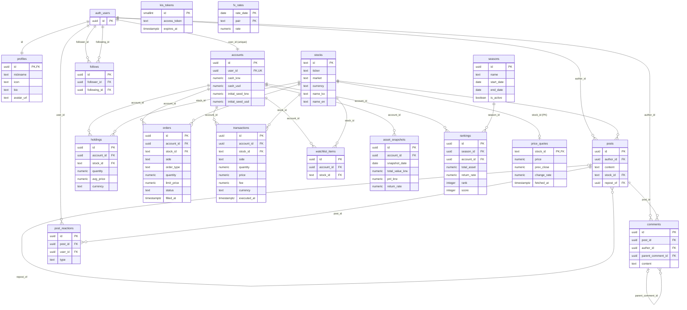

# 03. ERD — 데이터 모델 (v1.0 최종, 2026-11-06 운영 DB 실측)

> `pg_class`·`pg_constraint`·`pg_indexes` 조회(2026-11-06) 기준. public 스키마 **테이블 17개(전부 RLS on) + 뷰 4개**. 함수·권한·cron은 [`07-API-Spec.md`](./07-API-Spec.md) 3~5절.

## 개요
- **거래**: `stocks` → `price_quotes`(시세 캐시) / `accounts` → `holdings` · `orders` · `transactions` · `watchlist_items` · `asset_snapshots`
- **소셜**: `profiles` · `posts`(리포스트는 자기참조 `repost_of`) · `comments`(중첩은 자기참조 `parent_comment_id`) · `post_reactions` · `follows`
- **랭킹**: `seasons` → `rankings`. 시즌은 월 단위 내부 집계 단위이며 화면에 노출하지 않는다 — v1.0 랭킹은 누적 수익률이라 시즌은 이름표일 뿐(#67 결정 2026-10-10, 스키마 변경 없음)
- **인프라**: `kis_tokens`(id=1 단일 행) · `fx_rates`
- 사용자 식별자는 `auth.users(id)`. `profiles.id`·`accounts.user_id`·`posts.author_id` 등이 모두 이를 참조한다

## ERD

`created_at`/`updated_at`은 생략. 전체 컬럼은 `supabase/migrations/001_init_schema.sql`(코어) · `20260628000001_social_schema_drift_recovery.sql`(소셜) · `20260729000001_season_ranking.sql`(랭킹).

## 제약 (운영 DB 실측)

| 테이블 | UNIQUE | CHECK |
|---|---|---|
| `accounts` | `user_id` — 유저당 계좌 1개 | |
| `stocks` | `(market, ticker)` | `market in (KR, US)`, `currency in (KRW, USD)` |
| `price_quotes` | PK `stock_id` — 종목당 1행 | **`price > 0`** (#121, 0원 체결 차단) |
| `holdings` | `(account_id, stock_id)` | `quantity >= 0`, `avg_price >= 0`, `currency in (KRW, USD)` |
| `orders` | | `side in (buy, sell)`, `order_type in (market, limit)`, `quantity > 0`, `status in (pending, filled, cancelled, rejected)`, limit이면 `limit_price` 필수 |
| `transactions` | | `side in (buy, sell)`, `quantity > 0`, `price >= 0`, `currency in (KRW, USD)` |
| `watchlist_items` | `(account_id, stock_id)` | |
| `asset_snapshots` | `(account_id, snapshot_date)` — 하루 1행, 덮어쓰지 않음 | |
| `post_reactions` | `(post_id, user_id)` — 글당 반응 1개 | `type in (like, dislike)` |
| `follows` | `(follower_id, following_id)` | `follower_id <> following_id` |
| `seasons` | `start_date` · `is_active where is_active`(활성 시즌 1개) | |
| `rankings` | `(season_id, account_id)` | |
| `kis_tokens` | | `id = 1` (단일 행) |

- 삭제 전파: 유저 삭제 → `profiles`·`accounts`·`posts`·`comments`·`post_reactions`·`follows` cascade. 계좌 삭제 → 보유·주문·거래·관심·스냅샷·랭킹 cascade. 글 삭제 → 댓글·반응 cascade, 리포스트의 `repost_of`는 **set null**. 종목 삭제 → `price_quotes`·`posts` cascade, `holdings`·`orders`·`transactions`·`watchlist_items`는 FK로 **차단**.

- `holdings.avg_price >= 0`은 `price_quotes.price > 0`과 기준이 다르다. 컬럼 단위 CHECK만 있고 **컬럼 간 관계 제약(`quantity > 0`이면 `avg_price > 0`)은 없다** — `quantity > 0, avg_price = 0`(공짜 보유) 행을 제약이 막지 못한다. 현재 쓰기 경로는 `execute_order` 하나뿐이고 평단은 체결가로 계산되며 체결가는 `price_quotes.price > 0`을 거치므로 실제로 0이 들어갈 길은 없다. 전량 매도는 행을 delete하므로 `quantity = 0` 행도 실제로는 생기지 않는다. 즉 코드가 그래서 안전한 상태이지 제약으로 보장된 것은 아니다. 고치려면 `check (quantity = 0 or avg_price > 0)` 한 줄이면 되지만 v1.0.0 동결 중이고 실피해 경로가 없어 **알고 미적용**(#197).

## 뷰 (FK 없음, 별도)

| 뷰 | 정의 | invoker/definer | 권한 |
|---|---|---|---|
| `posts_with_author` | `posts` + 작성자 닉네임·아이콘 + 좋아요·싫어요·댓글 수(서브쿼리 실시간 집계) | definer | authenticated SELECT만 (#187) |
| `feed_posts` | 위에서 `stock_id IS NULL`, 최신순 — 전역 피드 | definer | authenticated SELECT만 |
| `community_posts` | 위에서 `stock_id IS NOT NULL` — 종목 커뮤니티 탭 | definer | authenticated SELECT만 |
| `season_rankings` | `rankings` + `accounts.user_id` + 닉네임·아이콘. 잔고·시드 컬럼 없음 | **definer** (`security_invoker = false`, #180) | authenticated SELECT만 |

정의자 뷰는 RLS를 타지 않으므로 **뷰 권한이 곧 접근 제어**다. `season_rankings`를 definer로 둔 이유는 `accounts` SELECT 정책이 본인 행만이라 invoker 뷰에서는 타 유저 순위가 걸러졌기 때문(#180, 유저 1명일 때는 드러나지 않던 버그).

## 랭킹 데이터
- `seasons` — 활성 시즌은 항상 1개. `get_or_create_current_season()`이 조회 시점에 이번 달 시즌을 생성
- `rankings` — 계좌 총자산 · 가입 시드 대비 누적 수익률(`total_asset / initial_seed_krw - 1`) · 순위. `calculate_season_ranking()`이 매일 00:05·09:05 KST pg_cron으로 갱신(#157). `score` 컬럼은 v1.0 코드에서 사용하지 않음
- `asset_snapshots` — `snapshot_date`는 KST 날짜. 매일 00:00 KST cron + 계좌 생성 트리거로 기록. 계좌 수익률 추이 그래프(#135)가 사용. 시즌 기준점 리셋을 재개(v2 #47)하면 이 스냅샷으로 기준 자산을 소급할 수 있다
- 총자산 = KRW 현금 + KRW 보유 수량 × 시세(없으면 평단가). USD 보유분은 제외 (#47)

## v1.0에서 쓰지 않는 것
- `fx_rates` — 001에서 생성됐으나 코드 참조 0건. 해외 종목(v2 #120) 재개 시 환율용
- `stocks`의 US 4종목(AAPL·TSLA·NVDA·MSFT) — `SUPPORTED_MARKETS=["KR"]`로 목록·검색·호가에서 숨김(#120). `accounts.cash_usd`·`initial_seed_usd`도 같은 이유로 화면에 쓰지 않음
- `orders.order_type = 'limit'` — `execute_order`가 `pending`으로 등록만 하고 체결하지 않음. UI는 `market`만 보냄

## RLS 정책 요약
- 17개 테이블 전부 RLS on. 소셜 테이블(`posts`·`comments`·`post_reactions`·`follows`·`profiles`)과 `seasons`·`rankings`·`stocks`·`price_quotes`는 authenticated 읽기, `accounts`·`holdings`·`transactions`·`asset_snapshots`·`watchlist_items`는 본인(`is_my_account`)만
- 클라이언트 쓰기는 `posts`·`comments`·`post_reactions`·`follows`·`watchlist_items` INSERT/DELETE와 `profiles` UPDATE만. `accounts`·`orders`·`holdings`·`transactions` 쓰기는 `execute_order` RPC가 유일한 경로(#137·#142). `posts`·`comments` UPDATE 정책은 수정 UI가 없어 제거(#137)
- `posts` 삭제: `posts_delete_own` (`auth.uid() = author_id`)
- `post_reactions`에는 **UPDATE 정책을 의도적으로 두지 않는다**(#38 결정 2026-10-09). 좋아요↔싫어요 전환은 delete+insert. 카운트는 뷰 서브쿼리 실시간 집계라 드리프트 없음
- 스냅샷 함수(`account_total_assets_krw`·`capture_asset_snapshots`·`snapshot_new_account`)는 anon/authenticated `execute` 회수 — cron(postgres)과 트리거만 실행
